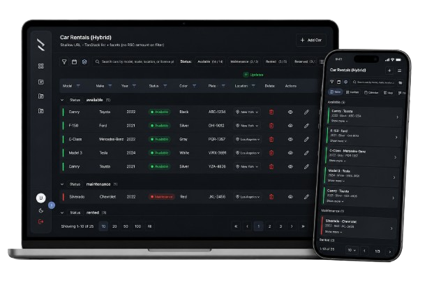

# Dashboard Architecture Starter

> A Next.js **dashboard starter kit** and **architecture lab**.
> Copy the kit to configure list pages. Follow the lab to understand RSC vs hybrid tradeoffs.

<table>
  <tr>
    <td align="left"><strong>Starter demo</strong> · <a href="#">Open →</a></td>
    <td align="right"><strong>The real product</strong> · <a href="#">Open →</a></td>
  </tr>
</table>

<p align="center">
  
</p>

---

## Choose your path

| | **Kit** | **Lab** |
|---|---------|---------|
| **You want** | Build/configure a dashboard page with filters, views, drawers | Understand rendering strategies and what broke along the way |
| **Start here** | [Starter kit](docs/guides/README.md) | [Lab → phase journey](docs/lab/README.md) |
| **Live demos** | Run locally, copy patterns from `/demo-rsc-page` and `/demo-hybrid-page` | Same routes — read step docs while clicking around |

---

## What this is

A **dashboard page** in this repo means: URL-driven list state (filters, sort, pagination, view mode), multi-view presentation (table, cards, kanban, …), optional record drawer, and loading/error UX.

**Variations** — same rental-cars domain, different data/render boundaries:

| Strategy | Idea | Best when |
|----------|------|-----------|
| **Server (RSC)** | URL → server loaders → Suspense islands | Read-heavy pages, shareable URLs, server as source of truth |
| **Hybrid** | RSC cold load + TanStack after hydration + shallow URL | Interactive filters/mutations without remounting the page |
| **Client-first** *(planned)* | Layout-scoped client, drafts, drag/drop | Rich local editing flows |

Platform pieces (`url-kit`, `multi-view`, `url-drawer`) are shared; only the fetch and mutation boundary changes.

---

## Why this exists

**Ever started another dashboard page and rebuilt the same filters, table chrome, drawer wiring, and URL state from scratch — then wondered why last time's patterns didn't carry over, and whether you're about to re-litigate the same server-vs-client tradeoffs all over again?**

This started as an internal accelerator: a shared boilerplate so the team could ship dashboard pages without rebuilding filters, tables, drawers, and URL state from scratch every time. New patterns land here first — a pagination fix, a drawer contract, a multi-view mode — and the kit grows with them.

As features were added, the architecture had to be part of the work too — not a fresh debate every time someone needs a new page. This lab captures those conclusions so we carry them forward: what stayed in the URL, when RSC was enough, when hybrid earned its complexity, and what we fixed along the way.

So the repo serves two goals that reinforce each other: **move faster on the next page**, and **get sharper on the architecture behind it**.

---

## Documentation

| Track | Entry |
|-------|-------|
| **Kit** | [`docs/guides/README.md`](docs/guides/README.md) → implementation plans |
| **Lab** | [`docs/lab/`](docs/lab/) → phase summaries + view journey docs |
| **Philosophy** | [`docs/architecture/philosophy.md`](docs/architecture/philosophy.md) — RSC vs hybrid, URL vs client |
| **Reference** | [`docs/reference/`](docs/reference/) — z-index, url-params transport |

Journey docs stay co-located with demos (`views/*/docs/`).

---

## Getting started

```bash
npm install
npm run dev
```

Open [http://localhost:3000/demo-rsc-page](http://localhost:3000/demo-rsc-page) and compare with `/demo-hybrid-page`.

- **Kit:** [Starter kit](docs/guides/README.md) → pick RSC or hybrid implementation plan
- **Lab:** [RSC journey](views/demo-rsc-page/docs/index.md) → [Hybrid journey](views/demo-hybrid-page/docs/index.md)
- **Not sure which stack:** [Architecture philosophy](docs/architecture/philosophy.md)
