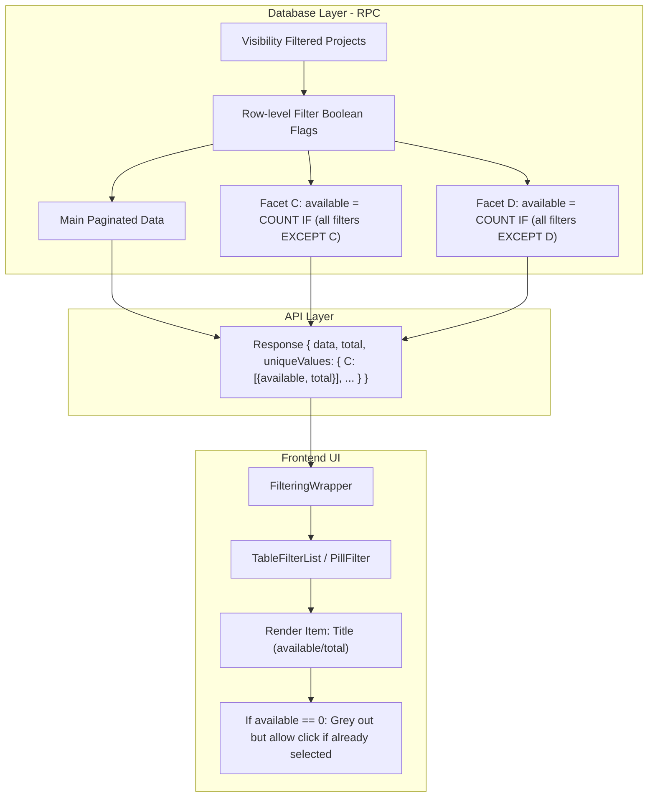

# Facet Filtering Implementation Plan

This plan describes the implementation of advanced faceted search with (available/total) counts and independent multi-select logic.

## Goal
Implement a high-performance faceted search system that follows the "drill-down" or "multi-select facet" pattern (AND between categories, OR within a category). This involves calculating counts for each facet independently by applying all filters except those for that specific category.

## Technical Strategy

### 1. SQL Optimization (The "Filtering Tree" Logic)
The primary change will be in `prisma/functions/get-projects-with-facets.sql`. We will use a single CTE pass to calculate filter bits and then aggregate counts using PostgreSQL's `FILTER (WHERE ...)` clause.

- **File**: `c:/projects/property-investment/prisma/functions/get-projects-with-facets.sql`
- **Strategy**: 
    - Create a CTE `base_projects` applying only organization visibility.
    - Create a CTE `row_filters` that evaluates every filter condition for every row as a boolean column (`f_status`, `f_company`, etc.).
    - In the final aggregation, calculate `available` for each facet using `COUNT(*) FILTER (WHERE [all filters EXCEPT current category])`.

### 2. API & Types Update
- **File**: `c:/projects/property-investment/features/filtering-wrapper-multi-display/types/filter-facets.ts`
- **Change**: Update `UniqueValueItem` to include `available: number` and `total: number`.

### 3. Frontend UI Updates
- **File**: `c:/projects/property-investment/features/filtering-wrapper-multi-display/components/PillFilter/TableFilterList.tsx`
- **Changes**:
    - Map `available` and `total` from the API facets to the internal `filterOptions`.
    - Update the badge display to show `(available/total)`.
    - Grey out options where `available === 0` but keep them visible and allow deselection.

## Mermaid Diagram

