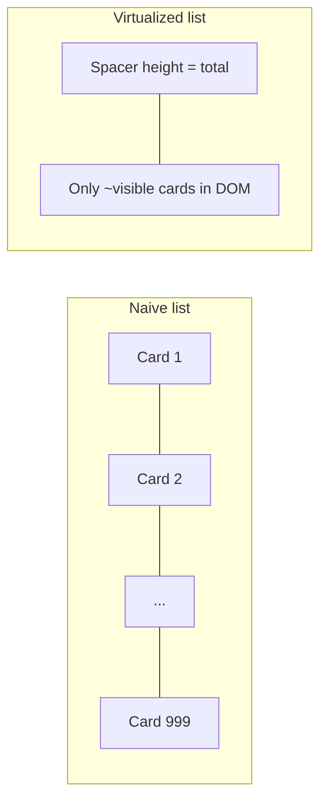
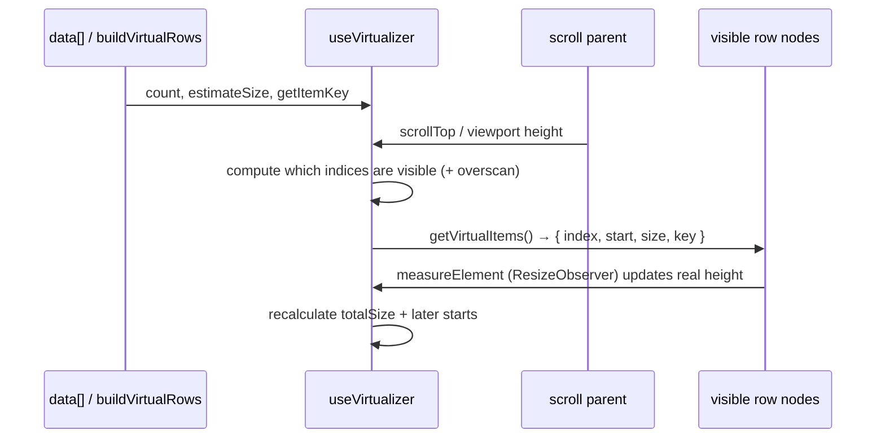

# How TanStack Virtual works (beginner guide)

This note explains **windowed virtualization** as used by the mobile-list (`cards`) view — assuming you have never used `@tanstack/react-virtual` before.

**Official docs (keep these open while reading):**

| Resource | Link |
|----------|------|
| Intro / why virtualize | [TanStack Virtual — Overview](https://tanstack.com/virtual/latest/docs/introduction) |
| React `useVirtualizer` | [React Virtual — useVirtualizer](https://tanstack.com/virtual/latest/docs/framework/react/react-virtual) |
| API reference | [Virtualizer API](https://tanstack.com/virtual/latest/docs/api/virtualizer) |
| Dynamic (measured) heights | [Dynamic example](https://tanstack.com/virtual/latest/docs/framework/react/examples/dynamic) |
| Package | [`@tanstack/react-virtual` on npm](https://www.npmjs.com/package/@tanstack/react-virtual) |

**Our code:**

| Piece | Path |
|-------|------|
| List host | [`components/list/mobile-list-wrapper.tsx`](../components/list/mobile-list-wrapper.tsx) |
| Flat row model | [`lib/virtualization/build-virtual-rows.ts`](../lib/virtualization/build-virtual-rows.ts) |
| Row types | [`types/virtualization/mobile-list-virtual-row.ts`](../types/virtualization/mobile-list-virtual-row.ts) |

---

## 1. The problem (why we need it)

If you render **every** card in the DOM:

```text
1000 cars → 1000 React trees → 1000 DOM nodes → slow scroll, high memory
```

Most of those cards are **off-screen**. The user only sees ~8–15 at a time.

**Virtualization** = only mount the rows that are (nearly) visible. Everything else is represented as empty scroll space.



---

## 2. Core idea in one sentence

> Pretend the list is tall (scrollbar is correct), but **only paint the rows inside the viewport** (plus a little overscan), positioned with `transform: translateY(...)`.

---

## 3. The three DOM layers

TanStack Virtual expects this nesting (we follow it in `MobileListWrapper`):

```text
┌─ 1. Scroll parent ─────────────────────────────┐
│  overflow: auto; height: 100%                  │
│  ref={parentRef}  ← virtualizer reads scrollY  │
│                                                │
│  ┌─ 2. Tall spacer ──────────────────────────┐ │
│  │  height = virtualizer.getTotalSize()      │ │
│  │  position: relative                       │ │
│  │                                           │ │
│  │   ┌─ 3. Visible row ────────────────────┐ │ │
│  │   │  position: absolute                 │ │ │
│  │   │  transform: translateY(start px)    │ │ │
│  │   │  ref={measureElement}               │ │ │
│  │   │  data-index={index}                 │ │ │
│  │   │  … GroupHeader or MobileCardItem …  │ │ │
│  │   └─────────────────────────────────────┘ │ │
│  │   ┌─ another visible row ───────────────┐ │ │
│  │   └─────────────────────────────────────┘ │ │
│  └───────────────────────────────────────────┘ │
└────────────────────────────────────────────────┘
```

| Layer | Job |
|-------|-----|
| **Scroll parent** | The element that actually scrolls. Virtualizer needs `getScrollElement()` → this node. |
| **Tall spacer** | Fake full height so the scrollbar thumb looks right for *all* rows. |
| **Absolute rows** | Only the windowed subset; each row’s `start` is its Y offset inside the spacer. |

---

## 4. Step-by-step: what happens at runtime



### Step A — Build a flat array

Virtualizers work on a **flat list of rows**, not nested groups.

We turn data into:

```text
[ group-header "Available (5)", card, card, …, group-header "Rented (3)", card, … ]
```

See `buildVirtualRows` → each entry is a `MobileListVirtualRow` (`kind: 'group-header' | 'card'`).

### Step B — Create the virtualizer

```ts
const virtualizer = useVirtualizer({
  count: virtualRows.length,           // how many logical rows exist
  getScrollElement: () => parentRef.current,
  estimateSize: (index) => …,          // first guess of each row’s height (px)
  overscan: 8,                         // extra rows above/below viewport
  getItemKey: (index) => virtualRows[index]?.id ?? index,
})
```

Important options (from the [API](https://tanstack.com/virtual/latest/docs/api/virtualizer)):

| Option | Meaning |
|--------|---------|
| `count` | Number of items in the flat list |
| `getScrollElement` | Returns the overflow scroll container |
| `estimateSize` | Returns estimated height for index `i` **before** we measure |
| `overscan` | Render N extra rows outside the viewport (smoother scroll) |
| `getItemKey` | Stable React key (we use card/group ids) |

### Step C — Ask “what should I paint?”

```ts
const items = virtualizer.getVirtualItems()
// each item: { index, start, size, key, … }
```

You **map only `items`**, not the full `virtualRows` array.

### Step D — Position each painted row

```tsx
style={{ transform: `translateY(${virtualItem.start}px)` }}
```

`start` is the Y offset from the top of the tall spacer. As you scroll, TanStack recalculates which indices are visible and their `start` values.

### Step E — Measure real height (dynamic cards)

Our cards change height when:

- “Show more” opens accordion fields
- “Details” opens the lifted `rowExpansion` sibling

So we cannot rely on fixed 76px forever. We attach:

```tsx
data-index={virtualItem.index}
ref={virtualizer.measureElement}
```

`measureElement` uses a [`ResizeObserver`](https://developer.mozilla.org/en-US/docs/Web/API/ResizeObserver) under the hood ([docs](https://tanstack.com/virtual/latest/docs/api/virtualizer#measureelement-1)). When the node’s height changes, the virtualizer:

1. Updates that row’s cached size  
2. Shifts `start` for rows below it  
3. Updates `getTotalSize()` so the scrollbar stays honest  

`estimateSize` is only the **initial guess** (headers ~36px, cards ~76px in our `estimateVirtualRowSize`).

---

## 5. Mental model: “window over a long tape”

```text
 Logical tape (all rows, not all in DOM):
 ├─0──1──2──3──4──5──6──7──8──9──10──11──…──N─┤
              ▲──────── viewport ────────▲
              │   overscan buffer        │
              └──── mounted in React ────┘
```

Scrolling moves the window. Rows leaving the window unmount; new ones mount.

---

## 6. How this maps to mobile-list

```mermaid
flowchart TB
  D[data: T] --> B[buildVirtualRows]
  B --> V[virtualRows: group-header | card]
  V --> U[useVirtualizer]
  U --> W[getVirtualItems]
  W --> H{row.kind?}
  H -->|group-header| G[GroupSectionHeader]
  H -->|card| C[MobileCardItem]
```

1. **Grouping** is solved *before* virtualization (`buildVirtualRows`), not by the virtualizer.  
2. **Virtualizer** only cares about: count, sizes, scroll position.  
3. **Card UI** (actions, accordion, expansion) lives inside each measured cell; when height changes, `measureElement` repairs the layout.

`onCellValueChange` still uses the original `data` index via `indexById` — virtual index ≠ data index when group headers are interleaved.

---

## 7. Common pitfalls (we already avoid most)

| Pitfall | Why it hurts | Our approach |
|---------|--------------|--------------|
| No fixed-height scroll parent | Virtualizer can’t know the viewport | Wrapper uses `h-full min-h-0 overflow-auto` |
| Mapping full `data` instead of `getVirtualItems()` | Defeats virtualization | Only map `items` |
| Missing `data-index` + `measureElement` | Dynamic heights jump / overlap | Always set both on the absolute row |
| Estimating wrong forever | Gaps or overlap until remount | Estimate + measure; accordion/expansion remeasure |
| Using nested group objects as `count` | Virtualizer needs a flat count | Flatten first |

---

## 8. Tiny glossary

| Term | Plain English |
|------|----------------|
| **Virtualization / windowing** | Only render what’s on (or near) screen |
| **Overscan** | Extra rows rendered just outside the viewport |
| **estimateSize** | Best-guess height before measuring |
| **measureElement** | “Weigh” the real DOM node and update the cache |
| **getTotalSize** | Sum of all row sizes → spacer height |
| **start** | Pixel offset of a row from the top of the list |

---

## 9. Suggested reading order

1. This file (problem + three layers + steps)  
2. [Introduction](https://tanstack.com/virtual/latest/docs/introduction)  
3. Skim our [`mobile-list-wrapper.tsx`](../components/list/mobile-list-wrapper.tsx) sections `3. Virtualization inputs` and `5. Virtual window render`  
4. [Dynamic example](https://tanstack.com/virtual/latest/docs/framework/react/examples/dynamic) (same measureElement pattern)  
5. [API](https://tanstack.com/virtual/latest/docs/api/virtualizer) when you need a specific option  

---

## 10. Related project docs

- Feature plan: [`MOBILE_LIST_OUTLINE.md`](./MOBILE_LIST_OUTLINE.md) (Step 4)  
- Boundaries: [`responsibilities.md`](./responsibilities.md) (`lib/virtualization`, `components/list`)
